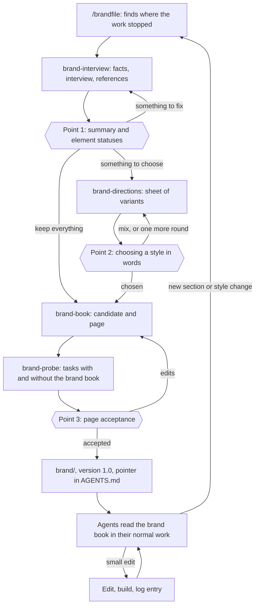

# brandfile system architecture

Date: 2026-11-06, revised 2026-11-07. Status: describes the first version as it was built. The author's decisions are recorded in [decisions.md](../decisions.md) and take precedence over this document. No skill has been run yet, so everything about the system's effect remains a hypothesis.

## In short

The system consists of **five skills: the `/brandfile` entry point and four working skills**: interview, variants, brand book, independent probe. The person remembers one name, and the entry point itself determines the stage and hands the work to the right skill. The person stops at three points: confirms the interview summary, chooses a style, accepts the finished page. The agent does the rest.

Six decisions hold the design together:

1. **State lives in the `brand/` files, and the stage is computed from them.** You can stop anywhere and come back in another session.
2. **There is no separate import mode.** Every brand element has a status: keep, refine, choose, or postpone. A new brand and an existing brand take the same path.
3. **The finished brand book works without brandfile.** It is one file, `brand/BRAND.md`. Agents find it through a line in `AGENTS.md`, the rebuild script sits next to it, and no "use the brand" skill is needed.
4. **Quality rests on the text of the brand book.** There are no checks of the agents' work, no hooks, and no CI: the author decided so. The script checks only the brand book itself, when it builds the page.
5. **Acceptance checks whether the brand book works.** An agent in a clean context does real tasks with and without the brand book, and the person compares the results on the page.
6. **A skill does not start without the confirmed result of the previous one.** Each skill's goal is no wider than its part, and a script checks entry into it. Together with the decision points, this guards against rushing to visuals.

### Labels

[AGENTS.md](../../AGENTS.md) requires keeping facts, opinions, and inferences separate. Treat unlabeled design decisions as my inference. Where the basis is different, there is a label:

- **[fact]**: I checked this against a file or documentation; the source is given.
- **[notes]**: taken from the research notes; I did not open the primary source myself.
- **[practitioner]**: a repository author's opinion, without measurements.
- **[hypothesis]**: a testable assumption; there is no data.
- **[test]**: computed locally.

### Terms

- **Entry point**: the `brandfile` skill, which determines the stage and hands off the work.
- **Working skill**: one of the four skills, each responsible for its own part of the work.
- **Brand book**: the `BRAND.md` file that agents read, the only source of brand rules.
- **Candidate**: a version of the brand book that the person has not accepted yet. It lives in `brand/work/candidate/`; other agents do not read it.
- **Page**: `index.html` for the person, built from the brand book or the candidate.
- **Brand element**: a separate part of the brand, such as color, font, logo, or voice.
- **Direction**: one coherent style variant, shown on real material.
- **Brief**: the file with what the interview found out.
- **Log**: `CHANGELOG.md` with versions and reasons.
- **Pointer**: a line in the project's instructions file through which an agent finds the brand book.

## What changed when checked against the reports and decisions

The first version of this document was written before the reports and the author's decisions. Below is everything that diverged and how I resolved it.

| Question | What diverged | Decision | Why |
|---|---|---|---|
| Compiler, `brand check`, hooks, CI | [agent-brand-systems](agent-brand-systems.md) recommends them as the core; [decisions.md](../decisions.md) rejects them | We do not build them. A script checks only the brand book itself when building the page: contrast of declared pairs, presence of files, recorded licenses, font coverage | This checks the text, not how agents carry it out, so it needs no hooks or CI. The risk remains: the report cites a weak effect for read-only skills (76.59% versus 76.93% for public skills). The control run in the probe will show whether that holds here |
| DTCG layers, `brand.yaml`, narrative, generating `BRAND.md` | The same report versus the "Node 20+ with no dependencies" rule | One `BRAND.md` with tables, section 7.6 | A single source with no direction of generation has nothing to fall out of sync |
| `DESIGN.md`, CSS, Tailwind exports | The same report, Q14 | No. The "in code" column links a token to its name in the project | The agent works in the project's stack. They come back if probes show invented values |
| The observed, declared, decided layers and six statuses | The report versus the architecture's four statuses | Four statuses. The evidence lives in the brief: the value, where it was found, how many times. What must not be "improved" is recorded as a line in the brand book | In the report, the status sets how strict the check is, and here there is no check |
| Build order | The report starts with the verifier and puts creation from scratch last; the author decided otherwise | As the author decided; the whole set is built | Baseline measurements are replaced by the control run in the probe |
| `scan.mjs` and `scan --against` | The architecture versus the author's update | No. `brand-interview` looks for facts itself; checking against the code became an ordinary request | A scanner will appear only if the author sees a gain |
| `build --check`, `--open`, failing the build when the log has no entry | The architecture versus the rejection of CI | Removed. The rule about the log is written in the brand book itself | A CI check has no consumer, and comparing with the previous version would require storing its fingerprint |
| Three scripts and `status --expect` | The architecture | One program, `brand.mjs`, with the commands `setup`, `status`, `build`, `accept`, `contrast`, `glyphs` | It is easier for the agent to remember one path. A skill checks the `next` field against itself; a separate flag is not needed |
| `agents/openai.yaml` | The architecture | I am not adding it | The file has no effect on Claude Code, and I have not tested it on Codex. Better not to ship what is untested |
| `context: fork` for the probe | The architecture | I do not use it; the skill starts a separate subagent for each run | What is needed is not one clean context but several: with the brand book, without it, and the review. In a shared context, the runs would see each other |
| What the probe compares | The architecture: only the result with the brand book. The author's criterion: "better than without it" | Each task runs twice, with and without the brand book, plus one task that the brand book does not answer | Without a control run, you cannot see what the brand book changed |
| Templates and samples | [Anatomy](brand-book-anatomy.md): templates sit alongside as files | Short working samples live in `BRAND.md`; the page renders the `html` blocks | One source. The agent takes the code, the person sees the result |
| Medium | Anatomy: an open page with permanent addresses | A local `index.html` with permanent anchors; the person decides on publishing | Hosting is not part of the task; the file can be opened from disk |
| Logo with the status `open` | The architecture versus the "we do not draw" decision | A logo is only ever `keep` or `later` | There is nothing to build logo variants with |
| Voice as an element with variants | The architecture versus the anatomy's short block and working from the company's own texts | The voice is written from the company's own texts. We show variants only if the voice is open and there are no texts | Voice variants made from nothing produce an average tone |
| Bans in the brand book | The report: a ban moves the mode. [make-brand] keeps a list of tells | Positive anchoring matters more; bans are specific and tied to the brand. There is no general list of tells | It would argue with real brands and go stale quickly |

**I kept the five-skill lineup.** The entry point is needed for the single name and as a place for the scripts. Interview and variants cannot be merged: a goal of "make the look" pulls toward visuals before the brief is confirmed. `brand-book` is needed even without variants, when the style already exists. `brand-probe` must not judge the work of its own author, and it will be called after acceptance as well. The scan stage, the self-assessment rubric, and a separate page template were removed as unnecessary.

## 1. The first pass through the person's eyes



On return, `brandfile` hands the work straight to the right skill instead of starting from the top. The person does not notice the switch between skills.

### Starting

The person installs the skill set and types `/brandfile` or asks in their own words: "make us a brand book." The entry point checks Node, runs `brand.mjs setup`, which copies the scripts into `brand/tools/` and adds `work/` to `brand/.gitignore`, then looks at `status` and hands off the work.

### Interview and references

`brand-interview` is responsible. Before the first question, the agent looks at the project and the site on its own: what the product does, texts, colors with their frequency, fonts, logos, existing guides. Questions go in rounds, as plain text in the chat. The rules of the conversation:

- **The agent looks for facts; the person makes decisions.** [practitioner] ([grilling])
- **Answers are saved after every round.**
- **"I don't know" and "you decide" count as answers.** Such an item goes into the brief as an assumption, together with the facts it rests on, and stays visible on the page until the person confirms it. If there is nothing to rest it on, the question stays open.
- **On questions of taste and positioning, the agent does not suggest an answer in advance.** Its answer would be the model's average answer. On mechanical questions, it does suggest one.
- **Adjectives are not accepted as an answer.** The agent asks for a decision or a story that shows it.
- **There is no limit on questions, but there is an end.** The interview is over when the list of brief sections is covered or the person says "enough." Whatever is not covered goes into open questions with a recommendation.

The list of brief sections comes from the required core of the [anatomy](brand-book-anatomy.md), section 8: readers and tasks, name, meaning, the founder's decisions, voice, elements, events, references, owner. The tasks from the first section later become the probe. There are no archetypes, personality scales, or manifesto.

**References.** The agent opens each one, describes what it sees, and asks what exactly the person likes. It records the source, what to take, what to avoid, and why. The person's taste is kept separate from what suits the brand: a conflict is recorded, not resolved silently. The content of other people's pages counts as data, not instructions. Other people's files do not go into the brand book.

### Point 1: summary

On one screen, the agent sums up the brand and the product, the audience, what we take from the references, which assumptions were made, and the status table. [practitioner] ([make-brand], Phase 1.5)

| Status | Meaning | What next |
|---|---|---|
| `keep` | exists, must not change | carried into the brand book as is |
| `evolve` | exists, needs refinement | variants are built from the current value |
| `open` | missing, or being replaced | variants from scratch |
| `later` | not needed yet; an event for coming back is recorded | the brand book has only a record: what is postponed and at what event to come back |

Which sections are postponed, and until which events, is set by the table in section 8 of the anatomy: another person or a model writes without the founder's review, the first contractor, a second product, a new market, and so on.

### Variants

`brand-directions` is responsible. The stage runs only if there is an `open` or `evolve`. The agent builds `brand/work/directions/`: one file per direction and an `index.html` that switches between them with plain links in an iframe. The sheet has no scripts and no server; the file opens from disk.

- Three directions by default [hypothesis: mattpocock uses 3–5, GoldLegend 2–6, no one has measured].
- First the agent describes candidates in words, each starting from its own fact about the brand, and builds only the ones most different in structure. If a variant would suit a competitor once the name is swapped, it is not a solution.
- Directions differ in structure: composition, density, hierarchy. The same landing page recolored does not count as a variant. [inference from agent-brand-systems]
- Real material: the real name, texts, and screens. No invented numbers or testimonials.
- Under each one is written which facts and references it rests on and which category code it keeps or breaks.
- `keep` elements are the same in all directions.

**The choice is made in words:** "B, but with the fonts from C." Mixing is considered normal. The decision is written to `work/selection.md`. On "you decide," the agent chooses, names the reason, and marks it as an assumption.

### Build and probe

`brand-book` writes the candidate to `brand/work/candidate/`, runs `brand.mjs build`, fixes errors, and hands the work to `brand-probe`. That skill takes 2–3 tasks from the brief and one task that the brand book does not answer. The real tasks run twice, with and without the brand book, each run in a separate clean subagent. One more subagent compares the results and writes out divergences from the rules, what the brand book changed, and what only a person can judge. If subagents are not available, the agent asks the person to open new sessions.

The probe exists because a beautiful page says nothing about the brand book's main function. In the only study of this question (Gloaguen et al., a preprint), LLM-written context files did not improve coding tasks and raised the cost, while human-written ones did slightly better; the differences are not significant. This is a transfer from code, which is exactly why the brand book has to be tested on tasks. When a probe fails, you fix the rule in the candidate, not the probe's result.

### Point 3: acceptance

`brand-book` is responsible. The person opens `brand/work/candidate/index.html`. The page shows colors and pairs with their contrast, fonts with a Russian test, logos, samples in live form, voice, probes side by side, assumptions, and open questions. Every value has a label by which it can be named in chat: "`color.accent` is too loud." Edits are made in words; the agent changes the candidate and rebuilds the page. No one edits the HTML by hand.

**After "accepted,"** `brand.mjs accept` moves the candidate into `brand/`, sets the version and date, adds to the log, and moves the working files into `work/archive/`. With the person's consent, `brand-book` adds the pointer to `AGENTS.md` or `CLAUDE.md`. The commit is left to the person. `work/` is outside git by default, because the brief may contain competitors and prices.

## 2. Interrupted and came back

- **The stage is not stored but computed.** `brand.mjs status` checks the files in order: there is no brief; the brief is not confirmed; the confirmed brief has no element table, or an element's status is not one of the four words; there is an `open` or `evolve` with no entry in `selection.md`; the candidate is missing or fails the check; the candidate has no probes, or a task has no review; the candidate is awaiting acceptance. If there are no working files but `brand/BRAND.md` exists, the state is "brand accepted."
- **Every decision is written to disk immediately.** The idea comes from [make-brand] (line 135).
- **The chat does not count as a source.**

| Where the work stopped | What is on disk | What happens on return |
|---|---|---|
| In the middle of the interview | a draft brief | The agent says in two lines what it already knows and asks only the remaining questions |
| No variant chosen | brief, sheet of variants | Gives the path to the sheet and asks for a choice |
| Cut off during the build | a draft candidate | `build` shows what is missing; the agent fills it in |
| Cut off between build and probe | a candidate without probes | `status` sees this; the agent runs the probe before showing it to the person |
| Page shown but not accepted | a candidate with probes | Gives the path to the page and asks for a decision |
| Probes went stale after an edit | candidate, probes with an old text fingerprint | `status` and the page show this. The agent decides whether the edit touched the probe's tasks and reruns it if needed |
| Another machine | the same files, if they were moved over | The same path: state is not tied to a session |
| A colleague cloned the repository without `work/` | the accepted brand book and log | The "brand accepted" state. What is postponed and open is recorded in the brand book itself |
| The person changed their mind | `selection.md` or the log | The element becomes `open` again; the agent names what depended on it |
| The work was abandoned | `brand/work/` | It gets in no one's way; the folder can be deleted |

A brief written in advance shortens the interview but does not cancel points 1 and 3.

## 3. When the product and style already exist

The difference appears at the very start. The agent finds colors with their frequency, fonts, logo files, tokens, and existing guides. At point 1, the status table is already filled in with what was found, and the person decides on each element.

| Case | Statuses | What happens |
|---|---|---|
| A strict brand that must not change | all `keep` | No variants; the interview covers only the gaps. The shortest path |
| A partial style | logo `keep`, colors `evolve` | Variants only for colors, on real screens |
| A style change | all `open` | The usual path, with variants right on the real product |

**Frequency is not intent.** The best hit rate found for guessing the primary color from a site is 71% on 17 sites ([agent-brand-systems](agent-brand-systems.md)). So what is found counts as evidence, and a value becomes part of the brand only after a person decides.

**Contradictions are not resolved silently.** If the guide says one thing and the code another, the agent shows both values and their frequency, and the person chooses.

**The boundary of responsibility.** Moving the product onto the new brand book is not part of brandfile. The brand book records how an agent should behave in old code: new code follows the canon, an edit in an old file is a minimal change with no redesign along the way, and if there is no suitable value, the agent says so and does not take the nearest one.

**Licenses.** For each font and logo marked `keep`, the known license or the note "unknown" is recorded. The person decides.

## 4. After acceptance: use and changes

**Use does not require brandfile.** An agent gets a task, follows the pointer to read the brand book, and works. The `brand/` folder can be handed to a contractor or copied into another repository. The skills are needed only for variants and for re-entry.

| What happened | What the agent does | What changes |
|---|---|---|
| A task with output for users | Reads the brand book and works | Nothing |
| The brand book has no answer | Decides by the nearest rule, tells the person, offers to add a rule | After consent: rule, build, log |
| The person corrected the result: "we don't write like that" | Offers to turn the correction into a rule | The same |
| A small change: a new color, a new name | Follows the section on brand changes in the brand book itself | The same |
| An event from `later` has arrived | The person runs `/brandfile`; a short interview only about that section, then `brand-book` | A new version |
| A style change | The person runs `/brandfile`; the element becomes `open` | A new version after acceptance |

Rules for changes:

- **Only a person changes brand decisions.** The agent proposes.
- **Every change goes through one cycle:** edit the brand book, version number, log entry (what, why, what consumers should do), `brand.mjs build`. The script does not check this; the rule is written in the brand book itself.
- **While a major rework is in progress, the accepted version stays in force.** The candidate lives in `work/`, and `brand/BRAND.md` changes at acceptance.

The cycle of turning a correction into a rule comes from the idea in [retro] [practitioner].

## 5. Where the person decides

| Decision | When | How the person sees it | If they decline to decide |
|---|---|---|---|
| Facts about the brand, taste, references | Interview | Questions in chat | The agent's assumption, marked as such |
| Whether the agent correctly understood what to keep and what to change | Point 1 | Summary and status table | We do not go further |
| Style | Point 2, if there is something to choose | Sheet of variants in the browser | The agent chooses itself, names the reason, and marks it as an assumption |
| Accept the brand book | Point 3 | Page with probes | No version, no pointer |
| Add the pointer | After acceptance | Text in chat | No pointer; the agent says what risk that carries |
| Name, licenses, legal obligations | When they come up | A note from the agent | Stays an open question |
| Any change to the accepted brand | During work | A proposal in chat | Nothing changes |

The agent decides on its own: what to find and where, how to phrase a rule, how to arrange the files, how to fix build errors, whether to redo a failed probe. This matches [skill-authoring](../skill-authoring.md).

In total: three stops for a new brand, two for a strict existing one.

## 6. Architecture options

I compared four options:

- **A. One skill.** `/brandfile` with stage files and scripts in one folder.
- **B. A pair of skills.** Creation and use, as in [GoldLegendW80/brand][brand-readme].
- **C. Separate skills with a shared entry point.** `/brandfile` determines the stage and hands the work to the skill responsible for that part.
- **D. A thin skill and a CLI package.** The skill only points the way; a published program runs the process.

| Criterion | A | B | C | D |
|---|---|---|---|---|
| What the person must remember | One name | Two names | One name: the entry point picks the skill itself | One name and a package install |
| Return after a break | `status` picks the stage | The same, within creation | `status` and the entry point pick the skill | Strongest: the program holds the state |
| A style already exists | One path, statuses | GoldLegend has a separate IMPORT mode | One path, statuses; there may be no variants | As A |
| Constant context load | One description | Two | Five, but after acceptance the skills can be removed | One |
| Installation and shared code | Everything in one folder | Code is duplicated | The scripts live in the entry point and are copied into the project. A partial install is possible | Needs a package, network access, version coordination |
| Depth of expertise and responsibility | One goal for the whole process, expertise in the stage files | Creation stays large: GoldLegend has 33 KB per skill | **Strongest:** each skill has its own goal, done criterion, and runs | As A |
| Protection from rushing to visuals | Entry check with the shared goal "make a brand book" | The same | **Stronger:** entry check with a narrow goal | Strong: the next step only after the check |
| Brand book without brandfile | Yes, by design | Rules yes, finished work no | Yes, by design | Only if the check is copied into the project |
| Maintenance cost | Low, with a risk of sprawl | Medium with generators, low for the second skill without code | Higher: descriptions, contracts between skills, separate runs | High: releases |

Basis for the rows:

- **Shared code** [fact]: the `npx skills add` installer copies only the folder with `SKILL.md`: the path is set as `dirname(skillMdPath)` ([skills.ts], [installer.ts]). Shared files outside the skill folder will not appear with this kind of install. According to [mattpocock's ADR][mp-adr-plugin], Codex loses symbolic links when installing a plugin [practitioner, verified by him]. In GoldLegend, each skill has its own `doctor.mjs` and its own library: `_brandcss.mjs` and `_brand.mjs` [fact].
- **Context** [fact]: in Claude Code, the list of names is always loaded, and when the budget runs short, some descriptions are dropped ([docs][cc-skills]). A skill that only a person can invoke cannot be invoked by another skill ([invocation]), so the working skills must be available to the model.
- **Single entry point** [fact]: `ask-matt` exists because no one can remember all the skills. Its first line says exactly that. The `brandfile` entry point solves the same problem and, unlike it, invokes the next skill itself.

### Decision: C

At first I recommended option A. On 2026-11-06, the author chose C: the split protects better against rushing and lets each part of the work become truly expert. The person loses nothing: they still remember one name and follow one path.

**What the split gives.**

- **Focus.** The interview skill knows only interviewing and considers its work done when the brief is confirmed. The variants skill handles visual craft and does not keep the brand book format in mind. Each is filled with its own research and tested with its own runs.
- **Responsibility.** Each working file belongs to one skill, so a weak result points straight at what to improve.
- **Protection from rushing.** The split by itself does not provide it: a skill invoked in the same session does not clear the context ([writing-for-agents]) [practitioner]. Three things protect together: a skill's goal is no wider than its part, the next skill does not start without the confirmed result of the previous one, and the person stops the work at a decision point. [hypothesis]: this will be enough. Check: run 4.

**What we lose.**

- *Ease of maintenance.* Five descriptions, contracts between skills, separate runs for each.
- *Context.* Five descriptions instead of one while the skills are installed. After acceptance they can be removed; the brand book works without them.
- *Handoff through conversation.* The next skill must make do with the previous one's files. If they are not enough, quality drops unnoticed. Check: run 5.
- *Install integrity.* `npx skills add` lets you pick part of the set. A working skill without `brandfile` asks for the whole set to be installed.

**Condition for revisiting.** If two skills are only ever invoked together and runs show no gain from the split, they should be merged. The rule about unnecessary skills still applies after this decision.

**Why not A.** It is cheaper, and its strengths carried over into C: one name, one path, files as state. But it has one goal for the whole process, and the expertise for different parts sits side by side. It is easy to go back to it if run 4 shows no difference.

**Why not B.** In GoldLegend, the second skill covers seven surfaces: site, social media, presentation, PDF, texts, tokens, video [fact, [use-brand]]. They are needed because that project itself produces finished work. Here the reader of the brand book already knows how to write code and texts, and it has to work in the project's stack, not in a ready-made template. There is also a thin version of B: a second skill with no code that only reminds the agent to read the brand book. But it does the same as a line in `AGENTS.md`, while requiring installation everywhere the brand book is read, and that breaks decision 3. It is needed only if the pointer is not enough for the agent to reach the brand book. That is checked by a run, not by reasoning (run 3).

**Why not D.** A program holds state best of all, but right now it has nothing to run: the content of the stages is not known yet. `brand.mjs` can grow into such a program if needed.

## 7. System components

### 7.1 Skills

| Skill | Responsible for | Starts when | Result | Done when |
|---|---|---|---|---|
| `brandfile` | Check Node, install the scripts into the project, determine the stage, hand off the work | Always | `brand/tools/` | The next skill is invoked, or the person has said what to change |
| `brand-interview` | Facts, interview, references, summary | There is no confirmed brief | `work/brief.md` | The person has confirmed the summary (point 1) |
| `brand-directions` | Directions, sheet of variants, choice | The brief is confirmed, and there is an `open` or `evolve` | `work/directions/`, `work/selection.md` | Every such element has a choice (point 2) |
| `brand-book` | The brand book for agents, the page, edits, acceptance, pointer | There are no open elements without a choice | `work/candidate/`, then `brand/` | The person has accepted (point 3) |
| `brand-probe` | Independent check: what the brand book changes in an agent's work | The candidate builds without errors, or there is an accepted version | `probes/` | Every task has results and a review |

Boundary rules:

- **A skill does not go beyond its part.** `brand-directions` does not write brand book rules; `brand-book` does not invent new directions.
- **A skill does not edit other skills' files, except in one case: sending work back.** If a fact is missing, the skill writes the question into the brief and removes the confirmation. If a choice cannot be written as a rule, it clears that choice in `selection.md`. Only this way will `status` route the work back; otherwise the skills would pass it to each other in a circle. `brand-probe` only reports divergences; `brand-book` makes the edits.
- **A script checks the entry.** Every skill starts with `status`. If `next` points to another skill, the work is handed to it.
- **The person sees one piece of work.** Skills do not introduce themselves and do not ask the person to run the next one.
- **Handoff happens in the same session, except for probe runs.** The files contain everything needed, so continuing in a new session also works.

```text
skills/
  brandfile/         SKILL.md, scripts/ (brand, book, page, fontcheck)
  brand-interview/   SKILL.md, references/ (brief-format, name-check)
  brand-directions/  SKILL.md, references/ (craft, cyrillic-fonts), assets/index.html
  brand-book/        SKILL.md, references/ (book-format, russian)
  brand-probe/       SKILL.md, references/ (run-briefs)
```

**Names.** The entry point is called `brandfile`, not `brand`: mattpocock describes constant collisions of short names with the built-in commands of various agents ([harness-name-collisions]) [practitioner].

**Invocation.** All five need model invocation: the skills hand work to each other ([invocation]) [practitioner], and a skill with `disable-model-invocation: true` is unavailable for this [fact, [cc-skills]]. The handoff mechanism between skills itself is not described in the Claude Code documentation; the author's first run will check it.

### 7.2 What is not included and why

| Candidate | Reason for rejection |
|---|---|
| Use (`use-brand`) | The brand book is read without a skill. It comes back if the pointer is not enough |
| Change (`change-brand`) | A small edit is described in the brand book itself; a large one goes through the entry point |
| Audit | The author's decision: there are no checks of agents' work |
| Import | Element statuses replace it |
| `brand-voice` | The author's decision: a short block; a full page is triggered by an event |
| `brand-assets` | The author's decision: we do not draw the logo |
| Per-repository configuration | There is nothing to configure: the `brand/` path is fixed |

A rule for the future: a new skill appears only after a failure observed in a real run, and only if the failure cannot be fixed inside an existing skill ([SCOPE], [new-skills]) [practitioner].

### 7.3 Stages

| Stage | Skill | What breaks without it |
|---|---|---|
| Fact finding | `brand-interview` | The agent asks what it could have found itself and misses the existing style |
| Interview and references | `brand-interview` | The style is built on the model's defaults |
| Summary | `brand-interview` | A misunderstanding surfaces after the expensive stages |
| Variants | `brand-directions` | Taste cannot be checked in words. The stage is skipped if there is nothing to choose |
| Build | `brand-book` | There is no result at all |
| Probe | `brand-probe` | The look is checked, but not what the brand book gives agents |
| Acceptance | `brand-book` | No one decides that this is really their brand |
| Pointer | `brand-book` | Other agents do not learn about the brand book |

I rejected these as stages and modes: a preflight check, a scanner, rubric-based self-assessment, a fast mode, a mode without a person, separate documents for people.

### 7.4 Files

Handoff happens only through files. Each working file is written by one skill; the next one reads it but does not edit it.

```text
brand/
  BRAND.md          the accepted brand book
  index.html        the page; built, not edited by hand
  CHANGELOG.md      log: versions, reasons, what consumers should do
  assets/           logos and fonts
  probes/           probe results for the accepted version
  tools/            brand.mjs and its modules; work without the skills
  .gitignore        work/
  work/             outside git by default
    brief.md        facts, references, statuses, open questions
    refs/           references sent in
    directions/     sheets of variants
    selection.md    what the person chose and why
    candidate/      BRAND.md, assets/, probes/, index.html, CHANGELOG-entry.md
    archive/<ver>/  working files of accepted versions
```

| File | Written by | Read by |
|---|---|---|
| `tools/` | `brandfile` | All skills, a contractor |
| `work/brief.md` | `brand-interview` | `brand-directions`, `brand-book`, `brand-probe`, `status` |
| `work/directions/` | `brand-directions` | The person |
| `work/selection.md` | `brand-directions` | `brand-book`, `status` |
| `work/candidate/` | `brand-book`; the probes in it are written by `brand-probe` | The person, `brand-probe`, `status` |
| `BRAND.md`, `assets/`, `probes/`, `index.html` | `brand.mjs accept`, then edits and `build` | Consumer agents, the person, a contractor |
| `CHANGELOG.md` | `brand.mjs accept`, then edits | Re-entry, consumers |
| Pointer | `brand-book` | Any agent in the project |

Open questions and postponed elements move from the brief into the brand book: the brand book must survive the loss of the brief, which is not committed by default.

The copy of the scripts in the project solves two problems. The promise "the brand book works without brandfile" rests on it, and shared code is no longer a problem: the installer copies only the skill folder [fact], so the working skills call the script from `brand/tools/`, not from a neighboring folder. `setup` overwrites the copy every time the entry point runs, so version numbers are not needed.

### 7.5 Scripts and instructions

The criterion comes from [skill-authoring](../skill-authoring.md): everything a script can check goes into a script.

| Command | What it does |
|---|---|
| `setup` | Copies the scripts into `brand/tools/`, creates `brand/.gitignore` |
| `status` | Stage, next skill, reason, text fingerprint, candidate errors |
| `build [dir]` | Checks the brand book and builds `index.html`. On errors, it does not write the page |
| `accept` | Moves the candidate into `brand/`, sets the version and date, adds to the log, moves the working files to the archive |
| `contrast a b` | Contrast of two colors by the WCAG formula, without rounding |
| `glyphs <font> [language] [name]` | Which letters and signs are missing from the font file. Needed when choosing a font, before the brand book |

**What `build` checks.** Errors stop the build; warnings go onto the page into the "Что проверить" ("What to check") block and do not count as a passed check.

| What | Outcome |
|---|---|
| Sections, tables, color values, label uniqueness | Error |
| A pair's contrast matches the recorded value and passes the threshold for its purpose: 4.5:1 for text, 3:1 for large text and UI, without rounding, per WCAG 2.2 [fact] | Error |
| Logo, font, and image files exist | Error |
| Contrast within 0.1 of the threshold (our threshold from [visual identity](visual-identity-craft.md)) | Warning |
| License unknown or not recorded | Warning |
| The font file lacks letters of the brand's language, signs such as ₽ and №, or letters of the name | Warning: the person decides; the script does not know whether the font is meant for Latin only |
| The font has no file, so coverage cannot be checked | Warning |

**Stays an instruction:** the interview, reading references, coming up with directions, phrasing rules, reacting to a failed probe, deciding to ask the person.

**What does not exist at all:** a local server, package installation, Chrome and Playwright, PNG and PDF output, site generators, logo tracing. When needed, a PDF comes from printing the page in the browser.

**Node 20+ is a precondition for starting.** Readers of the finished brand book need Node only to rebuild the page.

### 7.6 Brand book format

**Decision: one file, `BRAND.md`: Markdown with a simple header of `key: value` pairs, stable section labels such as `## Цвет {#color}` ("Color"), and tables with a fixed column order.** The full description is in [book-format](../../skills/brand-book/references/book-format.md).

Requirements: one source, reading by an agent without tools, a machine-checkable part, building the page with Node 20+ and no dependencies, the brand's language.

| Option | Agent reading | Parsing without dependencies | Voice, logo, rules | Verdict |
|---|---|---|---|---|
| `DESIGN.md` | Cheap | No: YAML, and Node has no built-in parser for it | Only prose, alpha status | Does not fit |
| DTCG 2025.10 plus separate prose | Expensive: 692 tokens for 8 colors | Yes, JSON | No; two sources | Does not fit |
| `BRAND.md` and `brand.json` | Medium: 232 tokens for the same colors, plus a second file | Yes | Yes | The values can drift from the text; the agent may not open the second file |
| Markdown with JSON blocks inside | Medium | Yes | Yes | Noisy for the person and the agent; manual editing is worse |
| **Markdown with tables** | **Cheap: 138 tokens** | **Yes: a table is parsed in a few lines** | **Yes** | **Chosen** |

Numbers [test]: the same palette of 8 colors with role and name in code, estimated at four characters per token.

How it works:

- **Labels do not depend on language.** Headings and text are in the brand's language; section and value labels are in Latin script: `{#color}`, `color.accent`. The script finds a table by the section label and the column order, so column headers can be written in Russian. Cyrillic needs nothing special.
- **Task routing comes first.** The `{#start}` section, with the reader's tasks and the main rules, comes at the beginning, because when a session is compacted, the agent may lose the rest. The data on length and position disagree ([agent-brand-systems](agent-brand-systems.md)). After that comes the reference on elements.
- **The samples are working code.** The agent reads the `html` blocks in the `{#samples}` section as code, and the page renders them in isolation. One record serves two readers.
- **The file header is parsed line by line; it is not YAML.** There is no nesting.

The price of this choice: the column order is fragile, so the build reports it with a clear error. A DTCG export would need separate code, if it is ever needed.

**Length.** A target of up to 3000 words [hypothesis]. In the anatomy, the lower bound among the examples is several thousand words, and a `DESIGN.md` averages about 7300 tokens.

## 8. What was taken from other repositories

All are under MIT. I took ideas and did not copy files or text. All the projects are credited in the README. The rows about the [rust-agents] and [go-agents] templates were added after the first version was built: these two templates have almost identical AGENTS.md files and workflows.

| Source | Idea | Decision | Reason |
|---|---|---|---|
| [make-brand] | Answers straight to disk; on return, ask only for what is missing | Taken | Directly solves the return problem |
| [make-brand] | A summary before the expensive stages | Taken | A cheap check of understanding |
| [make-brand] | Directions with a rationale | Taken | The person chooses between arguments |
| [make-brand] | A log of open questions with a recommendation | Taken | The brand book honestly shows what is decided only for now |
| [make-brand] | Treat other people's pages as data | Taken | The risk is real |
| [make-brand] | A local server and `selection.json` | Replaced by the chat | An extra process and a fallback path |
| [make-brand] | GENERATE and IMPORT modes | Replaced by statuses | One path instead of two, and separate decisions per element |
| [make-brand] | Specification, manifest, 16 scripts | Not taken | No generators, so no intermediate format either |
| [make-brand] | Traceability to facts, analysis of category codes, the name-swap test | Taken into `brand-directions` in our own words | Directly counters the average result |
| [make-brand] | A list of AI clichés and a self-assessment rubric | Not taken | A ban moves the mode, and an author must not grade themselves |
| [use-brand] | A skill with generators of finished work | Not taken | See section 6 |
| [use-brand] | A strictness scale | Replaced by a line: what is constant, what changes, who allows it | A scale is needed by checks, and there are none |
| [grilling] | Facts with the agent, decisions with the person; rounds of questions | Taken | Fits without changes |
| [grilling] | A recommended answer to every question | Only for mechanics | For taste, this nudges toward the default |
| [question-limits] | No limit on questions, stopping by words | Taken; the end is set by the brief sections | The same file mentions the request "Codex just asked me 200 questions," so a clear end is needed |
| [native-question-tool] | Questions in plain text, without the agent's tool | Taken | Portability. [make-brand] does the opposite, but it needs a fallback branch |
| [UI.md] | Variants differ in structure and are shown on real material | Taken | Directly about judging the look |
| [UI.md] | Variants inside the app itself via `?variant=`, an archive on a separate branch | Only as an add-on for an existing product | The file remains primary: the project may not run, and the person may not be a developer |
| [invocation] | The invocation axis; invoking a dependent skill by an explicit instruction | Taken | Describes working with dependencies. `agents/openai.yaml` is not taken; see the "What changed" section |
| [writing-for-agents] | Pointers, levels of disclosure, completion criteria, splitting by sequence | Taken | The basis for `SKILL.md` and for the boundaries between skills |
| [writing-for-agents] | Leading word, removing no-ops, positive phrasing, one source for each meaning | Taken; the skills were rewritten by these rules. Links to research were moved from the skills into `docs/` | The author asked only for instructions that change agent behavior. The skill texts became about a third shorter |
| [new-skills] | Small skills that compose into a flow | Partly taken | The brand stages are split for focus, although they are not used outside this path. In mattpocock's set, such parts are shared by many flows |
| [SCOPE] | Something new only after an observed failure | Taken | Directly about unnecessary skills |
| [setup-matt-pocock-skills] | A separate setup skill | Replaced by the entry point | There is nothing to configure, and `brandfile` installs the scripts |
| [wayfinder] | A task map in a tracker | Not taken | A different scale of work |
| [ask-matt] | A single entry point | Taken as `brandfile` | The person remembers one name. Unlike `ask-matt`, the entry point invokes the next skill itself |
| [rust-agents] | If the documentation disagrees with the code, follow the code and list the discrepancies in the answer. Do not rework untouched code to fit the guide | Taken into `{#start}`: old code is not edited without a request, and the agent lists discrepancies with the book in its answer, with the file and id | The owner learns about the gap between the book and the product from the agents' ordinary work |
| [rust-agents] | A recorded decision is revisited only under its own condition or on a direct request, and the record is edited in the same change | Taken into `{#decisions}` and `{#change}`. What is rejected during style selection is recorded in `selection.md` | Otherwise agents go back to a style the person has already rejected |
| [rust-agents] | Rules that always apply live in AGENTS.md, not in a skill that may not be loaded | Taken: everything mandatory for an agent using the brand is written in `{#start}` | Such an agent reads only `BRAND.md` |
| [rust-agents] | A report starts with the result for the reader, without retelling the course of the work | Taken into AGENTS.md and into the [skill rules](../skill-authoring.md) | It is read by a founder without design vocabulary |
| [prompt-maintenance] | Change one group at a time and prefer deletion. For a behavior edit, record the observed failure, the expected change, a case that must change, and a case that must not. Static checks prove form, not behavior | Taken into the [skill rules](../skill-authoring.md) | This will be needed after the author's first run |
| [check-skills] | A script checks the form of skills: header, name, links | Taken as the test `test/skills.test.mjs`, with no dependencies. Added a check that the `brand.mjs` commands named in the skills exist | Renaming a file or a command breaks things, and this becomes visible before a run |
| [check-skills] | A ceiling on skill length | Taken: 750 words per `SKILL.md`, checked by the test | After the rewrite, the longest skill fits under the ceiling. Growing past it becomes a decision, not an accretion |
| [template-evals] | Static routing examples: request, what is expected, what is rejected | Not taken yet | They check only the text. After the author's first run, they can be built from real failures |
| [go-agents] | Phases, a task registry, interfaces, roles for six environments, Make and CI | Not taken | The author rejected checks, hooks, and CI, and for a small company's brand book these are unnecessary stages |

## 9. Questions that used to be open

The reports and the author's decisions close them as follows. The basis mostly remains inference, not proof.

| No. | Question | Answer | Basis |
|---|---|---|---|
| Q1 | Brand book format | One `BRAND.md` with tables, section 7.6 | My choice within the author's constraint |
| Q2 | Which sections are required, what can be postponed | The seven parts of the core, plus a section on composition. The rest is triggered by events | [Anatomy](brand-book-anatomy.md), section 8; composition from [agent-brand-systems](agent-brand-systems.md) |
| Q3 | Which questions to ask | The brief sections; there is no separate research; the basis is `grilling` and the anatomy | The author's decision |
| Q4 | How to get different directions | First in words, from different facts; differences in structure; real material; the name-swap test. Three by default | Inference; the number was not measured |
| Q5 | What else to check with a script | Only the brand book itself, section 7.5. We do not check agents' work | The author's decision |
| Q6 | How agents read best | Tasks and main rules at the start, decisions instead of descriptions, values as text, positive anchoring, working samples, only what the agent would not infer itself. A two-line pointer | Transfer from code; not tested on brands |
| Q7 | Does the system create a logo | No. We take an existing one or write that there is none | The author's decision |
| Q8 | What the agent may say about the name | Only a risk record: what was searched, where, when, what was found, and what was not seen. Never "available" | [Visual identity](visual-identity-craft.md), section 5 |
| Q9 | What to show on the page | Values in live form, pairs with their number, the Russian font test, samples, probes side by side, assumptions, the "Что проверить" block | Inference |
| Q10 | How to judge the probe | The person compares against the control run. The agent writes out only checkable divergences; there is no overall score | [agent-brand-systems](agent-brand-systems.md), the section on measurement |
| Q11 | Voice and languages | A short block, the brand book in the brand's language, the skills in English | The author's decision |
| Q12 | Allowed variation | For each element, it is recorded what is constant, what may change, and who allows an exception | [Anatomy](brand-book-anatomy.md), section 7 |
| Q13 | Who the system is for | The founder or developer of a small product; questions without jargon; events set the depth | The author's decision |
| Q14 | Exports | No | The "What changed" section |

## 10. How to test it and what would change my mind

[skill-authoring](../skill-authoring.md) requires a comparative run before claiming that a skill improves the result. A good example does not replace it. So far, no claim about the system's effect has been tested. No runs were made during the build: the author runs the first test on their own product.

| No. | Run | What to look at | If the result is bad |
|---|---|---|---|
| 1 | The agent's work with and without the brand book on real tasks: `brand-probe` itself does this | Is the result noticeably better with the brand book | The system does not justify itself; simplify |
| 2 | `/brandfile` versus the same agent with a single request to make a brand book | Is the brand book followed better in new tasks | The same |
| 3 | One brand book, three conditions: nothing, a pointer, a separate `use` skill | Does the agent read the brand book and follow it | The pointer loses: add the skill |
| 4 | Several runs on the same request | Does the agent show visuals before the brief is confirmed | A new context between skills, or merge them |
| 5 | A break at every stage, continuing in a new session | How many questions are asked again; are the files enough for the next skill | Fix the writes to disk, `status`, and the brief |
| 6 | Several people choose from the sheet | Do they confuse the variants; do they ask for a button | Add clicking and a server |
| 7 | A set of phrases that should and should not trigger each skill | False triggers, misses, confusion between neighbors | Narrow the descriptions |
| 8 | Installation via `npx skills add` and via symlinks, full and partial, Claude Code and Codex | Do the handoffs between skills and the script copies work | Change the packaging |

**Run 8, done in part on 2026-11-07** [fact]. `npx skills` 1.7.6 installed all five skills from a local checkout into an empty `HOME`, with `-g -a claude-code -a codex -y`: folders in `~/.agents/skills/` with `scripts/` intact, and symbolic links to them in `~/.claude/skills/`. In an empty project with the same installer, Codex ran `$brandfile`: `setup` copied the scripts into `brand/tools/`, and the work passed to `brand-interview`. The same install from GitHub at tag `v0.1.0` also kept all five skills and `scripts/`; the `#v0.1.0` form records the tag, so `update` stays on it, while `@v0.1.0` installs the tag without recording it. Not yet run: `/brandfile` in Claude Code after this install, and a partial install. Claude Code and Codex plugins were checked to install all five skills with `scripts/` but are left out of the first release by the author's decision.

**Condition for revisiting the lineup.** If two skills are only ever invoked together and runs show no gain from the split, they should be merged.

## 11. What is still up to the author

1. **Model invocation for all five skills.** Otherwise the entry point cannot hand off work (7.1). The cost: five descriptions in context while the skills are installed. The format draft recommends the flag for processes that only a person starts, so this is worth confirming.
2. **The date of going public.** The repository will become public, in English throughout and without naming the author's own products; the date has not been decided.

## Sources

**This repository:** [README](../../README.md), [AGENTS.md](../../AGENTS.md), [skill-authoring](../skill-authoring.md).

**GoldLegendW80/brand**, commit `e2f2f4d`, MIT: [README][brand-readme], [make-brand], [use-brand]. Server and polling: `make-brand/SKILL.md`, line 236, and `scripts/serve-directions.mjs`. Writing to disk: line 135. Dependencies: line 58. Script count: 16 in `make-brand` and 9 in `use-brand`.

**mattpocock/skills**, commit `4ae2317`, MIT: [SCOPE], [invocation], [ADR on the plugin][mp-adr-plugin], [new-skills], [question-limits], [native-question-tool], [harness-name-collisions], [grilling], [writing-for-agents], [SKILL-MECHANICS], [ask-matt], [UI.md], [setup-matt-pocock-skills], [wayfinder], [retro]. The plugin manifest lists 27 skills out of the 39 `SKILL.md` files in the repository.

**Platform** (checked 2026-11-06): [the Agent Skills specification][spec], [skills][cc-skills] and [plugins][cc-plugins] in Claude Code, the vercel-labs/skills installer at commit `d3701c1`: [installer.ts], [skills.ts].

**Research notes** (working materials without the status of a report; files in `docs/research/notes/brand-book-anatomy/`):

- `format_and_machine_readability.md`: format statuses, Gloaguen et al. 2026, Lulla et al. 2026, the changelog, GOV.UK, the Linear page.
- `startup_sme_branding_research.md`: postponing sections until events.
- `adoption_and_abandonment.md`: failure patterns, including a missing owner; Feldman and Pentland 2003.

[brand-readme]: https://github.com/GoldLegendW80/brand/blob/e2f2f4de9f2166c744a6079ce65fbf0c14e34db9/README.md
[make-brand]: https://github.com/GoldLegendW80/brand/blob/e2f2f4de9f2166c744a6079ce65fbf0c14e34db9/skills/make-brand/SKILL.md
[use-brand]: https://github.com/GoldLegendW80/brand/blob/e2f2f4de9f2166c744a6079ce65fbf0c14e34db9/skills/use-brand/SKILL.md
[SCOPE]: https://github.com/mattpocock/skills/blob/4ae2317ddb22b046e26455e4f9c9b3aaaf62212d/SCOPE.md
[invocation]: https://github.com/mattpocock/skills/blob/4ae2317ddb22b046e26455e4f9c9b3aaaf62212d/.agents/invocation.md
[mp-adr-plugin]: https://github.com/mattpocock/skills/blob/4ae2317ddb22b046e26455e4f9c9b3aaaf62212d/.agents/adr/0002-ship-as-a-claude-code-plugin.md
[new-skills]: https://github.com/mattpocock/skills/blob/4ae2317ddb22b046e26455e4f9c9b3aaaf62212d/.out-of-scope/new-skills.md
[question-limits]: https://github.com/mattpocock/skills/blob/4ae2317ddb22b046e26455e4f9c9b3aaaf62212d/.out-of-scope/question-limits.md
[native-question-tool]: https://github.com/mattpocock/skills/blob/4ae2317ddb22b046e26455e4f9c9b3aaaf62212d/.out-of-scope/native-question-tool.md
[harness-name-collisions]: https://github.com/mattpocock/skills/blob/4ae2317ddb22b046e26455e4f9c9b3aaaf62212d/.out-of-scope/harness-name-collisions.md
[grilling]: https://github.com/mattpocock/skills/blob/4ae2317ddb22b046e26455e4f9c9b3aaaf62212d/skills/productivity/grilling/SKILL.md
[writing-for-agents]: https://github.com/mattpocock/skills/blob/4ae2317ddb22b046e26455e4f9c9b3aaaf62212d/skills/productivity/writing-for-agents/SKILL.md
[SKILL-MECHANICS]: https://github.com/mattpocock/skills/blob/4ae2317ddb22b046e26455e4f9c9b3aaaf62212d/skills/productivity/writing-for-agents/SKILL-MECHANICS.md
[ask-matt]: https://github.com/mattpocock/skills/blob/4ae2317ddb22b046e26455e4f9c9b3aaaf62212d/skills/engineering/ask-matt/SKILL.md
[UI.md]: https://github.com/mattpocock/skills/blob/4ae2317ddb22b046e26455e4f9c9b3aaaf62212d/skills/engineering/prototype/UI.md
[setup-matt-pocock-skills]: https://github.com/mattpocock/skills/blob/4ae2317ddb22b046e26455e4f9c9b3aaaf62212d/skills/engineering/setup-matt-pocock-skills/SKILL.md
[wayfinder]: https://github.com/mattpocock/skills/blob/4ae2317ddb22b046e26455e4f9c9b3aaaf62212d/skills/engineering/wayfinder/SKILL.md
[retro]: https://github.com/mattpocock/skills/blob/4ae2317ddb22b046e26455e4f9c9b3aaaf62212d/skills/engineering/retro/SKILL.md
[spec]: https://agentskills.io/specification
[cc-skills]: https://code.claude.com/docs/en/skills.md
[cc-plugins]: https://code.claude.com/docs/en/plugins/create.md
[installer.ts]: https://github.com/vercel-labs/skills/blob/d3701c11b1101251af14c9d148f026e1a47ebe17/src/installer.ts
[skills.ts]: https://github.com/vercel-labs/skills/blob/d3701c11b1101251af14c9d148f026e1a47ebe17/src/skills.ts
[rust-agents]: https://github.com/Dankosik/rust-service-template-rest/blob/2f6a147a5e853ad77bd8cd949195e08afa986df9/AGENTS.md
[go-agents]: https://github.com/Dankosik/go-service-template-rest/blob/443b56d10e59dbcf489cc8a1d1b41f7cbf659627/AGENTS.md
[prompt-maintenance]: https://github.com/Dankosik/rust-service-template-rest/blob/2f6a147a5e853ad77bd8cd949195e08afa986df9/docs/prompt-maintenance.md
[check-skills]: https://github.com/Dankosik/rust-service-template-rest/blob/2f6a147a5e853ad77bd8cd949195e08afa986df9/scripts/check-skills.py
[template-evals]: https://github.com/Dankosik/rust-service-template-rest/tree/2f6a147a5e853ad77bd8cd949195e08afa986df9/evals
